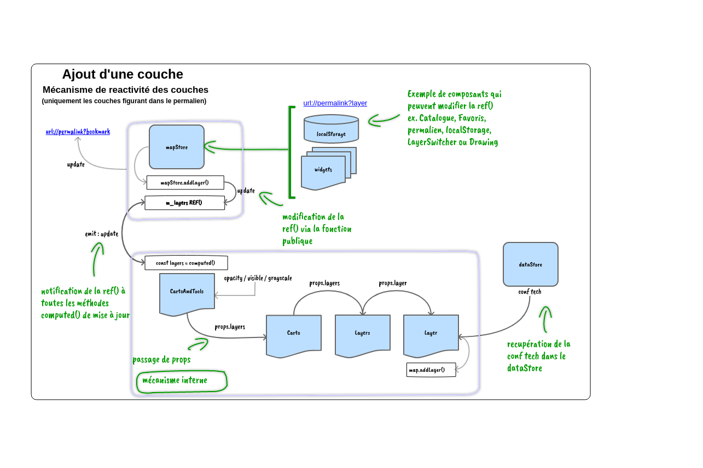
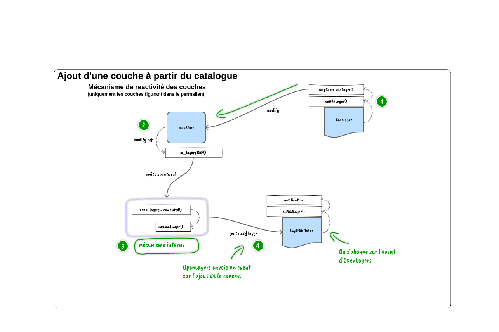
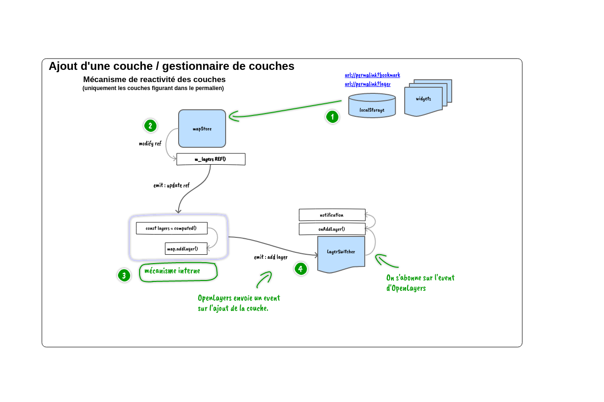
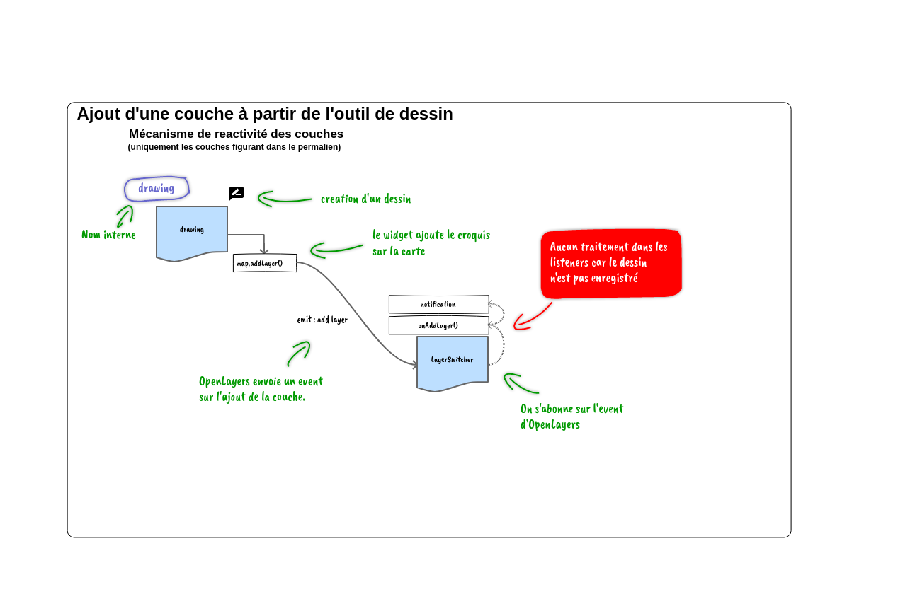
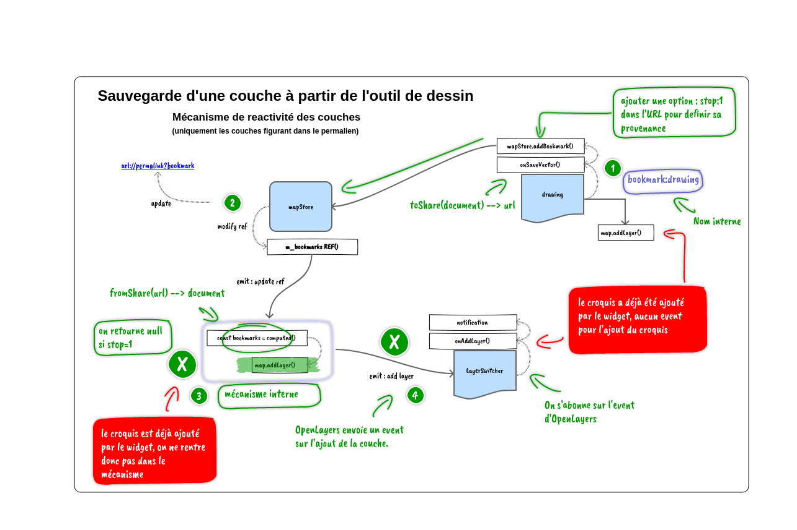
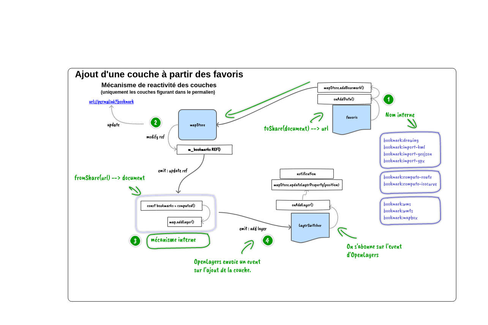
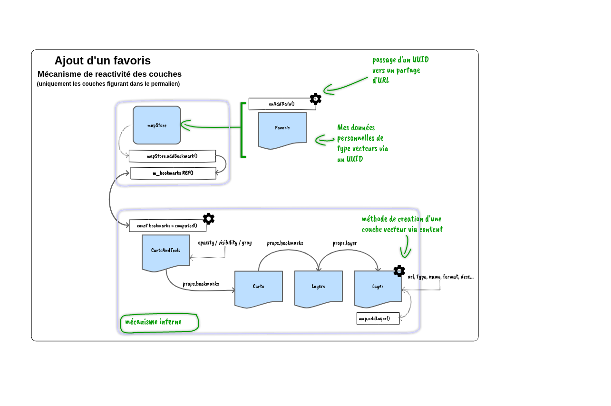
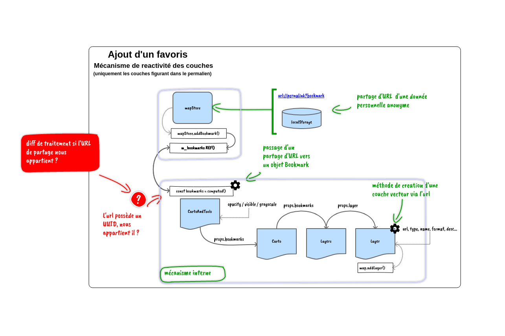
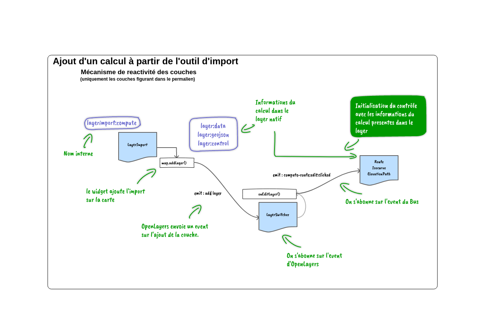
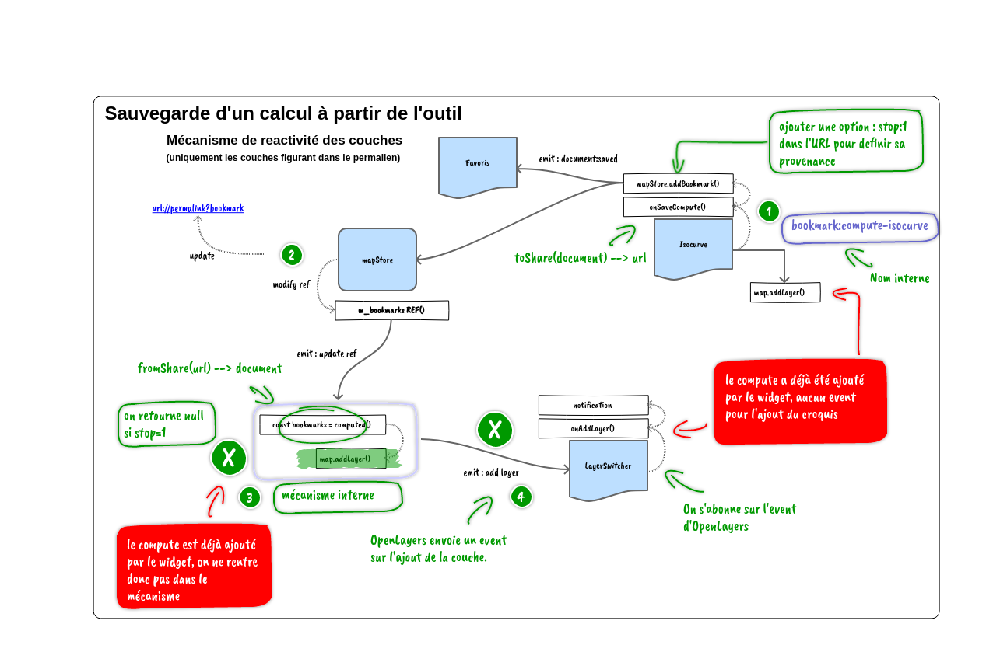

# Workflow d'ajout d'une couche sur la carte

Ce guide décrit le parcours d'une couche depuis une action utilisateur jusqu'à
son affichage dans OpenLayers. Il s'adresse aux intégrateurs et développeurs de
l'entrée cartographique et s'appuie sur les schémas PNG présents dans ce dossier.

Les schémas donnent une vue d'ensemble. Les noms et comportements détaillés
ci-dessous correspondent au code actuel ; certains libellés des images sont
historiques, notamment les références génériques à « Catalogue » et aux permaliens.

## Sommaire

- [Workflow d'ajout d'une couche sur la carte](#workflow-dajout-dune-couche-sur-la-carte)
  - [Sommaire](#sommaire)
  - [1. Distinguer sélection, affichage et enregistrement](#1-distinguer-sélection-affichage-et-enregistrement)
  - [2. Chaîne réactive des couches du catalogue](#2-chaîne-réactive-des-couches-du-catalogue)
    - [Que contient le store ?](#que-contient-le-store-)
    - [Création de la couche et chargement des données](#création-de-la-couche-et-chargement-des-données)
  - [3. Rôle du gestionnaire de couches](#3-rôle-du-gestionnaire-de-couches)
  - [4. Créer et enregistrer un croquis](#4-créer-et-enregistrer-un-croquis)
    - [Dessin non enregistré](#dessin-non-enregistré)
    - [Sauvegarde sans créer une deuxième couche](#sauvegarde-sans-créer-une-deuxième-couche)
  - [5. Importer un fichier ou un service](#5-importer-un-fichier-ou-un-service)
    - [Import vectoriel sauvegardé](#import-vectoriel-sauvegardé)
    - [Réutilisation des constructeurs](#réutilisation-des-constructeurs)
  - [6. Ajouter un favori ou un document partagé](#6-ajouter-un-favori-ou-un-document-partagé)
    - [Depuis l'espace personnel](#depuis-lespace-personnel)
    - [Depuis un lien partagé](#depuis-un-lien-partagé)
  - [7. Afficher et rééditer un calcul](#7-afficher-et-rééditer-un-calcul)
    - [Afficher ou importer le résultat](#afficher-ou-importer-le-résultat)
    - [Enregistrer sans dupliquer le résultat](#enregistrer-sans-dupliquer-le-résultat)
  - [8. Identifiants, partage et marqueur stop](#8-identifiants-partage-et-marqueur-stop)
    - [Identité de catalogue et identité documentaire](#identité-de-catalogue-et-identité-documentaire)
    - [Pourquoi stop ne doit pas être partagé tel quel](#pourquoi-stop-ne-doit-pas-être-partagé-tel-quel)
    - [Ajout à la sélection et publication d'un document](#ajout-à-la-sélection-et-publication-dun-document)
  - [9. Intégration et diagnostic](#9-intégration-et-diagnostic)
    - [Choisir un seul pilote d'ajout](#choisir-un-seul-pilote-dajout)
    - [Points de contrôle](#points-de-contrôle)
  - [10. Répertoire des schémas](#10-répertoire-des-schémas)

## 1. Distinguer sélection, affichage et enregistrement

Trois états ne doivent pas être confondus :

| État | Support | Ce qu'il représente |
| --- | --- | --- |
| Sélection cartographique | `mapStore`, stockage local et permalien | Les couches et références nécessaires pour retrouver une composition de carte |
| Affichage | Collection de couches de la carte OpenLayers | Les instances effectivement ajoutées à la carte et leurs propriétés de rendu |
| Enregistrement personnel | `Service`, API de documents et `serviceStore` | Les documents enregistrés sur le serveur pour un utilisateur connecté |

Ajouter une couche à la carte ne signifie donc pas l'enregistrer dans l'espace
personnel. Inversement, un document enregistré n'est pas nécessairement affiché.
Retirer une couche de la sélection n'équivaut pas à supprimer son document distant.

Deux voies d'ajout coexistent :

- Les références persistantes du catalogue et des documents partagés passent par
  le store, puis par la chaîne de composants qui reconstruit les couches.
- Les outils, par exemple le dessin ou l'import, peuvent créer directement une
  couche OpenLayers ; son enregistrement et sa référence de partage sont ensuite
  traités séparément.

## 2. Chaîne réactive des couches du catalogue

Le parcours principal est le suivant :

1. L'utilisateur sélectionne une entrée du catalogue.
2. Le contrôle émet `catalog:layer:add` ;
   [CatalogManager.vue](../src/components/carte/control/CatalogManager.vue) récupère
   l'identifiant correspondant avec `dataStore.getLayerIdByName(name, service)`.
3. Si l'identifiant existe, `mapStore.addLayer(id)` l'ajoute à la sélection.
4. Les propriétés calculées de
   [CartoAndTools.vue](../src/components/CartoAndTools.vue) reconstruisent les
   informations nécessaires à partir du store et de la configuration du catalogue.
5. Les props traversent `Carto.vue`, puis
   [Layers.vue](../src/components/carte/Layer/Layers.vue).
6. `Layers.vue` filtre les configurations invalides, prépare les propriétés et
   instancie un [Layer.vue](../src/components/carte/Layer/Layer.vue) par couche.
7. `Layer.vue` crée la couche adaptée au service, applique ses paramètres, puis
   appelle `map.addLayer(layer)` et émet son événement de montage.
8. L'ajout à la collection OpenLayers est observé par le gestionnaire de couches.

### Que contient le store ?

[mapStore.js](../src/stores/mapStore.js) conserve une représentation sérialisée
des références du catalogue, pas les instances OpenLayers.
`addLayer(id, props)` ignore un identifiant absent ou déjà sélectionné.
Sans propriétés explicites, les valeurs ajoutées sont `(-1;1;1;0)` :

| Position dans la référence | Propriété | Valeur initiale |
| --- | --- | --- |
| 1 | `position` | `-1`, position automatique |
| 2 | `opacity` | `1` |
| 3 | `visible` | `1`, soit vrai |
| 4 | `grayscale` | `0`, soit faux |
| 5, facultative | `style` | Style d'une couche vectorielle tuilée |

Le store expose les méthodes `getLayers()`, `getLayerProperty(id)`,
`updateLayerProperty(id, properties)` et `removeLayer(id)` pour travailler sur ces
références. Il s'appuie sur le stockage local ; les paramètres de permalien
permettent aussi de reconstruire une sélection à l'ouverture d'une URL.

### Création de la couche et chargement des données

Pour les couches du catalogue, `Layer.vue` utilise notamment `GeoportalWMS`,
`GeoportalWMTS` ou `GeoportalMapBox` selon le service. La configuration provient
du `dataStore`, et les options de visibilité, d'opacité, de position et de style
proviennent de la sélection.

Le montage d'une instance et la fin du chargement de ses données ne sont pas le
même signal. Une source peut encore télécharger des tuiles ou des entités après
`map.addLayer()`. Ne pas utiliser un délai fixe comme preuve que les données sont
disponibles ; suivre les événements adaptés à la couche et à sa source.

Si une création de couche du catalogue échoue, `Layer.vue` remonte une erreur à
`Layers.vue`. Celui-ci retire la référence du store et affiche un avertissement,
afin d'éviter de restaurer indéfiniment une entrée défectueuse.

## 3. Rôle du gestionnaire de couches

[LayerSwitcher.vue](../src/components/carte/control/LayerSwitcher.vue) relie les
instances présentes sur la carte aux actions de gestion : ordre, visibilité,
opacité, niveaux de gris, suppression et édition selon le type de couche.

La boucle complète comporte donc deux sens :

- **Sélection vers carte** : une modification du store provoque la création,
  la mise à jour ou le retrait de composants de couche.
- **Carte vers sélection** : les actions du gestionnaire et les événements
  OpenLayers répercutent les propriétés utiles dans le store.

Pour une couche persistante, ne pas modifier uniquement une instance OpenLayers
en oubliant sa référence de store : sa restauration pourrait retrouver l'ancien
état. À l'inverse, ne pas ajouter manuellement une seconde instance si le même
ajout est déjà piloté par la chaîne réactive.

## 4. Créer et enregistrer un croquis

### Dessin non enregistré

Le contrôle [Drawing.vue](../src/components/carte/control/Drawing.vue) encapsule
l'outil de dessin des extensions OpenLayers. Le widget gère sa propre couche :
elle est déjà présente sur la carte avant tout enregistrement personnel.

Le gestionnaire de couches peut l'afficher, mais cette présence ne constitue pas
une référence documentaire persistante. Dans le helper vectoriel du projet, un
dessin sans UUID reçoit l'identifiant interne `drawing`.

### Sauvegarde sans créer une deuxième couche

1. L'utilisateur demande l'enregistrement du croquis.
2. Le composant prépare le contenu, le nom, la description, le format et le type.
3. Si l'utilisateur n'est pas connecté, le dessin peut être conservé comme
   document temporaire dans l'`appStore`, sans appel de création sur l'API.
4. Une fois connecté, l'action `useCreateDocument` appelle `Service.setDocument()`.
   Pour un document déjà enregistré, le parcours utilise `useUpdateDocument`.
5. L'action de création affecte à la couche existante un identifiant du type
   `bookmark:drawing-kml:UUID`, met à jour son entrée de gestionnaire si elle existe,
   demande le partage du document, complète ses métadonnées puis émet `document:saved`.
6. Le composant retrouve le document dans le cache du service, fabrique sa référence
   avec `toShare(document, { ..., stop: 1 })` et l'ajoute par `mapStore.addBookmark()`.
7. `CartoAndTools` décode la référence mais l'écarte de `selectedBookmarks` tant
   que `stop` est actif : la couche gérée par l'outil n'est pas recréée.

L'option `stop` ne veut donc pas dire « document non enregistré » : elle veut dire
« ne pas ajouter une seconde instance via la chaîne réactive dans ce contexte ».

Les actions communes sont dans
[actionSaveButton.js](../src/components/carte/control/actions/actionSaveButton.js).
Leur demande de partage est une opération serveur distincte du simple ajout à la
carte : vérifier les règles de confidentialité des documents utilisés.

Après retour de connexion, la restauration du brouillon attend que la catégorie
des croquis soit chargée. Le guide
[Authentification et documents](integration-authentification-documents.md)
détaille la synchronisation de session et le service documentaire.

## 5. Importer un fichier ou un service

[LayerImport.vue](../src/components/carte/control/LayerImport.vue) encapsule l'outil
d'import. Celui-ci peut afficher des fichiers vectoriels, des services et des
résultats de calcul, sans que ces données soient déjà enregistrées sur le serveur.

L'ajout initial relève du widget : une couche peut être visible immédiatement
alors qu'aucune référence personnelle n'existe encore.

### Import vectoriel sauvegardé

Le parcours actuel de `saveImportVector` diffère volontairement de celui du dessin :

1. Le composant prépare les données avec `type: 'import'` et le format concerné.
2. `useCreateDocument` crée le document et notifie l'espace personnel.
3. La couche temporaire du widget est retirée par `map.removeLayer(data.layer)`.
4. `toShare(document, properties)` produit une référence, sans `stop: 1` dans ce parcours.
5. `mapStore.addBookmark(url)` ajoute cette référence à la sélection.
6. La chaîne `CartoAndTools` → `Carto` → `Layers` → `Layer` recrée alors la couche
   à partir de sa référence documentaire.

Il ne faut donc pas appliquer mécaniquement la stratégie du dessin à tous les
imports : ici, retirer puis recréer la couche est intentionnel.

### Réutilisation des constructeurs

Les constructeurs de [layer.js](../src/features/layer.js) sont choisis selon le
type et le format de la référence :

| Helper | Cas principal |
| --- | --- |
| `createVectorLayer(options)` | KML, GPX ou GeoJSON, à partir de contenu ou d'une URL |
| `createServiceLayer(options)` | Service WMS ou WMTS |
| `createMapBoxLayer(options)` | Style Mapbox / données vectorielles tuilées |
| `createComputeLayer(options)` | Résultat de calcul avec informations de réédition |

Les helpers renvoient des promesses de couches. Leur résolution ne prouve pas
toujours que la source a terminé tous ses téléchargements. Pour les vecteurs
chargés par URL, surveiller notamment `featuresloadend`, `featuresloaderror` et les
détails d'erreur de la source. CORS reste nécessaire pour les ressources externes.

## 6. Ajouter un favori ou un document partagé

### Depuis l'espace personnel

Le gestionnaire `onAddData` de
[MenuBookMarkEntry.vue](../src/components/menu/bookmarks/MenuBookMarkEntry.vue)
pilote l'ouverture d'un document enregistré :

1. Il recharge les métadonnées avec `service.getDocumentById(data.id)`.
2. Il sélectionne la méthode de lecture selon le type : `getDrawing`, `getImport`,
   `getCompute`, `getService` ou `getCartes`.
3. Pour un croquis, un import, un service ou un calcul, il génère une référence
   avec `toShare(document, properties)` puis appelle `mapStore.addBookmark(url)`.
4. `CartoAndTools` décode chaque référence avec `fromShare()` et construit
   `selectedBookmarks`, sauf si le marqueur `stop` l'exclut.
5. `Layers.vue` transmet la description à `Layer.vue`, qui sélectionne le helper
   adapté et ajoute la nouvelle instance à OpenLayers.

Les documents de type **`carte`** sont un cas particulier : ils représentent une
composition de carte, pas une unique couche vectorielle. Le composant lit leur
contenu et utilise `loadPermalink()` ou `setShortPermalinkData()` selon le format.
Il ne faut pas les envoyer comme une couche ordinaire au cas `type: 'carte'` de
`Layer.vue`, qui n'implémente pas cette création.

### Depuis un lien partagé

Une référence provenant d'un permalien ou du stockage local peut alimenter
`mapStore.bookmarks`, même si le document ne figure pas dans le cache de l'espace
personnel de l'utilisateur courant. La reconstruction suit ensuite la même chaîne
réactive que les autres références documentaires.

`toShare()` sérialise les informations du document et ses propriétés de rendu ;
`fromShare()` les restitue sous forme d'objet. Ces fonctions se trouvent dans
[share.js](../src/features/share.js).

Un UUID ou une référence `bookmark:` n'est **pas une preuve de propriété ni un
contrôle d'accès**. La consultation d'une URL partagée dépend de sa disponibilité
et de ses droits d'accès. Les téléchargements de sources par URL ne reçoivent pas
automatiquement le Bearer du service documentaire : ne pas supposer qu'un lien
vers une ressource privée fonctionne comme une URL publique.

## 7. Afficher et rééditer un calcul

Les contrôles
[Route.vue](../src/components/carte/control/Route.vue),
[Isocurve.vue](../src/components/carte/control/Isocurve.vue) et
[ElevationPath.vue](../src/components/carte/control/ElevationPath.vue)
gèrent respectivement les itinéraires, les zones calculées et les profils altimétriques.

### Afficher ou importer le résultat

Un résultat affiché par un outil ou importé est une couche qui doit aussi conserver
les informations nécessaires à sa réédition. Pour les références documentaires,
`createComputeLayer()` lit notamment les extensions `geoportail:compute` et attache
des propriétés telles que `control`, `data` et `geojson` à la couche.

Lors d'une demande d'édition depuis le gestionnaire, `LayerSwitcher.vue` reconnaît
le type grâce à l'identifiant et/ou à la propriété `control`, puis envoie un
événement au contrôle approprié :

| Événement | Contrôle destinataire |
| --- | --- |
| `compute-route:edit:clicked` | `Route.vue` |
| `compute-isocurve:edit:clicked` | `Isocurve.vue` |
| `compute-profil:edit:clicked` | `ElevationPath.vue` |

Une géométrie seule peut donc être suffisante pour l'affichage mais insuffisante
pour restaurer les paramètres du calcul dans le bon outil.

### Enregistrer sans dupliquer le résultat

Le parcours de sauvegarde reprend le principe du dessin : création du document,
mise à jour de l'identifiant de la couche, génération de l'URL de partage avec
`stop: 1`, puis ajout de la référence au store. La couche existante reste gérée
par l'outil ; la référence n'en déclenche pas une seconde création.

Les noms visibles dans les schémas, comme `bookmark:compute-isocurve`, représentent
des familles d'identifiants ; l'identifiant effectif contient aussi l'UUID du document.

## 8. Identifiants, partage et marqueur stop

### Identité de catalogue et identité documentaire

| Origine | Identité utilisée |
| --- | --- |
| Catalogue | Clé de configuration obtenue par `dataStore.getLayerIdByName()` |
| Dessin temporaire | Identifiant de widget ; `drawing` dans le helper vectoriel |
| Import vectoriel non enregistré | Exemple de forme du helper : `layerimport:kml` |
| Croquis enregistré | `bookmark:drawing-kml:UUID` |
| Import enregistré | Exemple : `bookmark:import-geojson:UUID` |
| Calcul enregistré | Exemple : `bookmark:compute-route:UUID` |
| Service enregistré | Les helpers peuvent utiliser `bookmark:wms:UUID`, `bookmark:wmts:UUID` ou `bookmark:mapbox:UUID` |

L'action de création utilise la forme générale
`bookmark:${type}-${compute || format}:${uuid}`. Certains helpers de reconstruction
utilisent une forme plus courte selon le type. Ne pas considérer les exemples
comme une unique grammaire valable pour toutes les couches : vérifier le producteur
et les branches de reconnaissance dans `LayerSwitcher.vue`.

`gpResultLayerId` lie la couche à son origine et à son document. `gpResultLayerDiv`
peut également conserver le lien avec son entrée dans le gestionnaire de couches.
Ces propriétés servent aux actions d'édition et de synchronisation ; ce ne sont
pas des garanties de sécurité.

### Pourquoi stop ne doit pas être partagé tel quel

`stop` est un marqueur interne d'évitement des doublons. Dans la représentation
réduite de partage, il est associé à la clé `s`.

Le code actuel ne fait **pas** retourner `null` à `fromShare()` pour ce marqueur,
contrairement au raccourci écrit dans certains PNG. `CartoAndTools` décode l'objet,
puis applique le filtre `if (!obj.stop)` avant de l'ajouter aux props de couche.

Le store retire le marqueur sérialisé `s=1` lors de la restauration prévue et de
la construction des liens de permalien/partage. Ainsi, dans une nouvelle ouverture,
la couche peut être recréée à partir du document même si aucun widget ne l'a encore
ajoutée. Conserver ce marqueur dans un nouveau lien risquerait de masquer une
référence pourtant valide.

Dans les schémas, les URL `...?layer` ou `...?bookmark` sont conceptuelles. Dans
l'état actuel du store, les paramètres de composition utilisent notamment `l`
pour le catalogue et `d` pour les références documentaires ; ne pas recopier les
libellés des images comme un contrat d'URL.

### Ajout à la sélection et publication d'un document

`mapStore.addLayer()` et `mapStore.addBookmark()` modifient la sélection locale.
Ils n'enregistrent rien dans l'API de l'espace personnel. `addBookmark()` évite
notamment de réajouter une référence ayant la même URL de base.

À l'inverse, `Service.setDocument()` crée un document distant et met à jour le cache
documentaire. C'est le composant ou l'action applicative qui décide ensuite de sa
publication, de sa référence de partage et de l'ajout à la carte.
Les événements `document:saved` et les événements de montage de couche ne sont pas
interchangeables : un document peut être sauvegardé alors que sa couche est déjà là.

## 9. Intégration et diagnostic

### Choisir un seul pilote d'ajout

Avant d'intégrer un nouveau point d'entrée, déterminer qui crée la couche :

1. Pour une entrée existante du catalogue, rechercher sa clé dans le `dataStore`
   et utiliser `mapStore.addLayer()` plutôt qu'un ajout OpenLayers parallèle.
2. Pour un document partagé à reconstruire, utiliser une référence compatible avec
   `toShare`/`fromShare`, puis `mapStore.addBookmark()`.
3. Pour un widget qui possède déjà sa couche, décider explicitement de la conserver
   avec `stop`, ou de la retirer puis de la recréer par la chaîne réactive.
4. Préserver les informations nécessaires à l'édition, notamment l'origine,
   l'UUID et les paramètres des calculs.
5. Mettre à jour les références de sélection lorsque les propriétés de rendu changent.
6. Vérifier séparément création de l'instance, chargement de la source,
   enregistrement distant et restauration dans une nouvelle ouverture.

Pour les erreurs de chargement, consulter aussi
[loader.js](../src/features/loader.js) et les mécanismes d'erreur de
[layer.js](../src/features/layer.js). Le marquage de préparation de la carte est
utile pour les tests, mais ne garantit pas à lui seul la réussite de tous les
téléchargements distants.

### Points de contrôle

| Symptôme | Vérifications prioritaires |
| --- | --- |
| Une entrée catalogue ne s'affiche pas | Identifiant retourné par le `dataStore`, référence du store, props de `Layers.vue`, création dans `Layer.vue` |
| Une couche apparaît deux fois | Ajout direct du widget plus ajout réactif ; marqueur `stop` ou retrait de la couche temporaire manquant |
| Une couche enregistrée ne revient pas à l'ouverture | Référence de partage absente, marqueur `stop` conservé, URL publique indisponible ou configuration invalide |
| Le gestionnaire ne conserve pas l'ordre ou l'opacité | Identifiant de couche et retour des modifications vers les propriétés du store |
| Un calcul s'affiche mais ne se réédite pas | `gpResultLayerId`, propriété `control`, extension `geoportail:compute`, événement destinataire |
| Le document existe mais aucun élément n'est dessiné | Réponse HTTP, CORS, format, projection, contenu et événements de chargement de la source |
| Une carte enregistrée est traitée comme un simple calque | Utilisation du parcours de permalien au lieu d'une construction `type: 'carte'` dans `Layer.vue` |
| La suppression d'une couche surprend l'utilisateur | Distinguer retrait de la carte et suppression du document distant |

La recette doit couvrir le catalogue, un croquis non enregistré puis enregistré,
un import vectoriel sauvegardé, un favori, un résultat de calcul et un permalien
rouvert dans une nouvelle page. Vérifier pour chaque cas qu'il n'existe qu'une
instance attendue de la couche et que les propriétés de rendu sont restaurées.

## 10. Répertoire des schémas

Les illustrations sont conservées dans leur format PNG d'origine :

| Fichier | Lecture proposée |
| --- | --- |
| [layers.png](layers.png) | Chaîne réactive générale catalogue/store/composants/OpenLayers |
| [catalogue.png](catalogue.png) | Sélection d'une entrée du catalogue |
| [layerswitcher.png](layerswitcher.png) | Retour des propriétés depuis le gestionnaire de couches |
| [drawing1.png](drawing1.png) | Dessin ajouté directement par l'outil |
| [drawing2.png](drawing2.png) | Sauvegarde du dessin et évitement d'une deuxième création |
| [bookmarks_1.png](bookmarks_1.png) | Référence provenant d'un lien partagé ou du stockage local |
| [bookmarks_2.png](bookmarks_2.png) | Référence d'un document personnel |
| [favoris.png](favoris.png) | Parcours d'ajout depuis l'espace personnel |
| [compute_1.png](compute_1.png) | Import et réédition d'un résultat de calcul |
| [compute_2.png](compute_2.png) | Sauvegarde d'un calcul déjà affiché |

Pour contribuer au projet, consulter
[CONTRIBUTING.md](../CONTRIBUTING.md) et le [workflow Git](workflow-dev.md).
